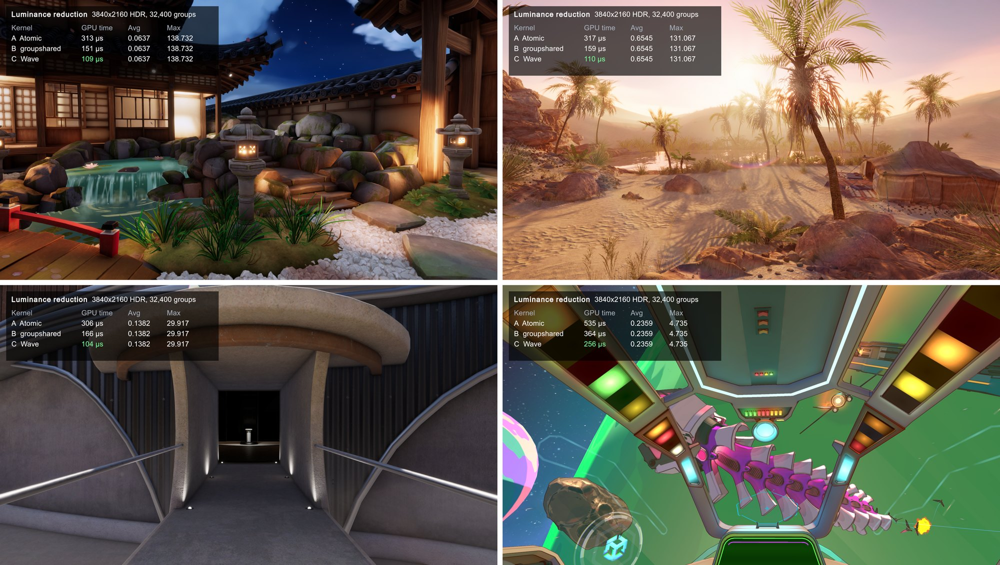

# Unity Wave Intrinsics Sample

Unity Universal 3D Sample 씬에서 화면 전체의 평균·최대 밝기를 세 가지 방식으로 구하고, 각 방식의 GPU 시간을 화면에 표시하는 예제입니다.

- **A · Atomic**: 모든 스레드가 전역 버퍼에 `InterlockedAdd` / `InterlockedMax`
- **B · groupshared**: `groupshared` 배열과 Barrier로 반씩 접어 합산
- **C · Wave**: `WaveActiveSum` / `WaveActiveMax`로 Wave별 결과를 구한 뒤 그룹 단위로 조금만 모음

설명 글: [Wave Intrinsics로 Compute Shader 합산 빠르게 하기](https://onestar-tau.vercel.app/posts/unity-wave-intrinsics/)

## 요구 사항

- Unity 6000.6.5f1 이상 (Unity 6.6, DX12용 DXC 지원)
- Windows + DirectX 12
- Wave 연산을 지원하는 GPU (Shader Model 6.0)

프로젝트 설정에서 Windows 그래픽스 API는 Direct3D12가 첫 번째로 되어 있습니다.  
에디터가 DX11로 떠 있다면 에디터를 다시 시작하세요.

## 실행

1. `Assets/Scenes`의 Garden, Oasis, Terminal, Cockpit 씬 중 하나를 엽니다.
2. Play를 누르면 왼쪽 위에 세 커널의 GPU 시간과 평균·최댓값이 표시됩니다.

GPU 시간은 최근 120프레임의 평균입니다. Game 뷰 해상도를 바꾸면 해당 해상도로 측정됩니다.

## 파일

| 파일 | 내용 |
|---|---|
| `Assets/WaveDemo/LuminanceReduce.compute` | A, B, C 커널 |
| `Assets/WaveDemo/LuminanceReduceFeature.cs` | URP Render Graph Compute Pass. 후처리 직전의 HDR 화면에 세 커널을 매 프레임 실행 |
| `Assets/WaveDemo/AutoExposure.cs` | 결과 readback, GPU 시간 집계, 화면 표시. Volume을 지정하면 결과로 자동 노출도 적용 |
| `Assets/WaveDemo/LuminanceReduce.cs` | 텍스처 하나로 정확도와 시간을 재는 에디터용 벤치마크 (`LuminanceReduce.Verify()`) |

측정 패스는 프로젝트의 모든 URP Renderer에 Renderer Feature로 추가되어 있고, 각 씬의 메인 카메라에 `AutoExposure` 컴포넌트가 붙어 있습니다.

## 라이선스

`Assets/WaveDemo`를 제외한 씬과 에셋은 Unity의 Universal 3D Sample 템플릿에 포함된 것으로, Unity의 라이선스를 따릅니다.
